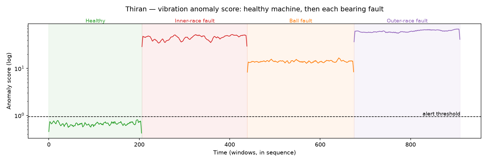
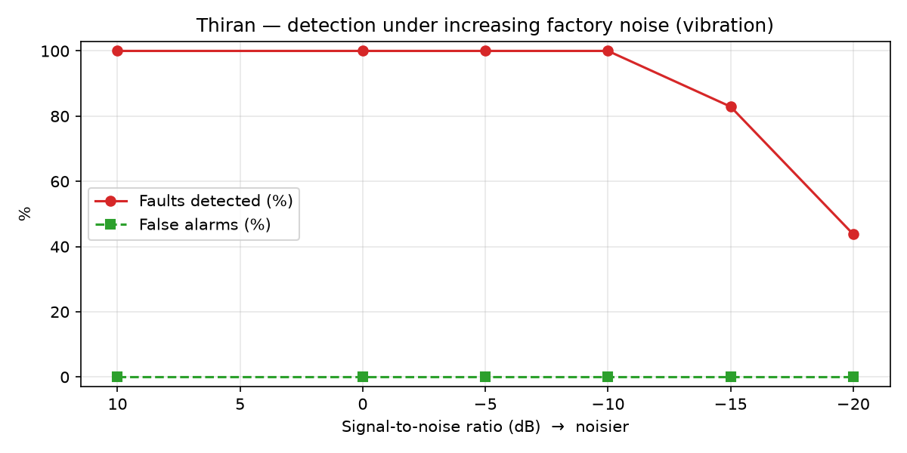
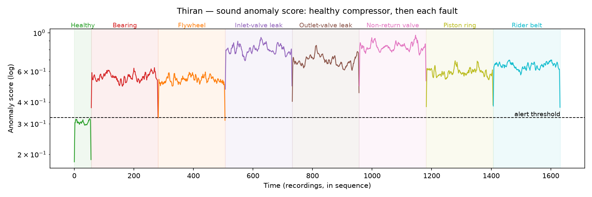
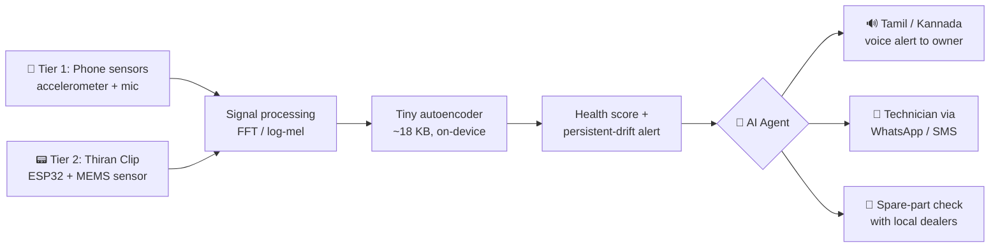

<div align="center">

# ⚙️ Thiran (திறன்)

### Offline AI that hears machine breakdowns before they happen

*Turning any low-cost smartphone into a predictive-maintenance system for India's small factories*


</div>

---

## 🔍 The Problem

Powerlooms, flour mills, pump sets and small machine shops run **ageing machines with no condition monitoring**. The owner is also the maintenance team and judges machine health by sound and feel.

- Machines run **until they fail**. Breakdowns are unplanned.
- Spare parts are sourced in a hurry at **emergency prices**.
- Every day of downtime means **missed deliveries and idle wages**, on already thin margins.
- Industrial monitoring systems are **too costly and complex** for these units, and there is **no labelled fault data** for their old, varied machines.

## 💡 Our Solution

***Thiran*** means **capability, strength and efficiency** in Tamil. Thiran keeps every machine running at full capacity by catching trouble **before** it becomes a breakdown.

| Step | What Thiran does |
|---|---|
| 📱 **Sense** | A low-cost Android phone captures the machine's **vibration** (accelerometer) and **sound** (microphone). No extra hardware is needed. |
| 🧠 **Learn normal** | An unsupervised autoencoder learns *that specific machine's* healthy signature. **No fault labels are required.** |
| 📉 **Detect drift** | The on-device model scores machine health continuously and raises an alert only on **sustained** drift, not one-off spikes. |
| 🤖 **Act (Agentic AI)** | An AI agent explains the issue by **voice in English, Tamil or Kannada**, suggests a repair window and, **with the owner's approval**, alerts the technician and checks spare-part availability. |

## 📊 Proof-of-Concept Results

The detector was validated on two public **real-machine** datasets. The model was **trained only on healthy data** and never saw a fault during training. All numbers below are produced automatically by `thiran_poc.ipynb`.

<!-- RESULTS:START -->
### Vibration — CWRU bearing dataset

| Condition | ROC-AUC | Detection rate |
|---|:---:|:---:|
| Inner-race fault | 1.000 | 100.0% |
| Ball fault | 1.000 | 100.0% |
| Outer-race fault | 1.000 | 100.0% |
| False alarms on healthy data | – | 0.0% |



### Stress test — added factory noise (vibration)

Background noise added to every signal; the model re-learns "normal" in the noisy setting, as it would on a real shop floor.

| Noise level (SNR) | Mean ROC-AUC | Detection rate | False alarms |
|---|:---:|:---:|:---:|
| 10 dB | 1.000 | 100.0% | 0.0% |
| 0 dB | 1.000 | 100.0% | 0.0% |
| -5 dB | 1.000 | 100.0% | 0.0% |
| -10 dB | 1.000 | 100.0% | 0.0% |
| -15 dB | 0.976 | 82.9% | 0.0% |
| -20 dB | 0.830 | 43.8% | 0.0% |



### Sound — industrial air-compressor dataset

| Condition | ROC-AUC | Detection rate |
|---|:---:|:---:|
| Bearing | 1.000 | 100.0% |
| Flywheel | 1.000 | 100.0% |
| Inlet-valve leak | 1.000 | 100.0% |
| Outlet-valve leak | 1.000 | 100.0% |
| Non-return valve | 1.000 | 100.0% |
| Piston ring | 1.000 | 100.0% |
| Rider belt | 1.000 | 100.0% |
| False alarms on healthy data | – | 8.8% |



**Model size:** 18,704 parameters (~18 KB in INT8), small enough to run in real time, offline, on a low-cost phone.
<!-- RESULTS:END -->

> ### Why are some scores near-perfect?
> The benchmark datasets are recorded in **controlled lab conditions** with clearly developed faults, so detection on clean data is expected to be near-perfect; published methods routinely report similar scores on them. That is exactly why we added the **noise stress test**: it shows how performance degrades as conditions get closer to a real, noisy shop floor, and where the method's limits are. Field validation on real factory machines is planned for the prototype round.

## 📶 Two-Tier Monitoring: Start Free, Upgrade When It Pays

| | **Tier 1: Phone (screening)** | **Tier 2: Thiran Clip (continuous)** |
|---|---|---|
| Hardware | The owner's existing smartphone in a ₹150 magnetic holder | ~₹400 clip-on sensor (ESP32 + MEMS vibration sensor) |
| How it's used | A 1-minute check per machine, daily or on the technician's round | Mounted permanently, monitoring 24/7 |
| Sampling | Phone accelerometer (~200–500 Hz) + microphone (16–48 kHz) | Vibration at kHz rates |
| Best at | Imbalance, misalignment, looseness, belt slip, valve leaks, late-stage bearing wear | Also **early-stage** bearing damage, with weeks of warning |
| Cost to owner | ₹0 hardware | Low one-time cost, for critical machines only |

**Same AI model, same app, same agent.** Owners start free with their phone, see the value, and upgrade their most critical machines. As an ECE/VLSI team, we design the Tier-2 sensor hardware ourselves.

## 🏗️ Architecture



## 🇮🇳 Built for Bharat

- **Low-cost phones:** start with zero hardware; add the optional ₹400 clip only where it pays
- **Offline-first:** detection runs on the device; agent actions sync when connectivity returns, with an SMS fallback
- **Voice-first:** alerts in English,Tamil or Kannada for low-literacy users
- **No labelled data:** learns each machine's own normal behaviour
- **Owner in control:** the decision to stop production always stays with the owner

## 💼 Business Model

- **Primary customers:** local technicians and equipment dealers, who gain the most from knowing which machines will fail. They can plan their week, stock parts in advance and sell maintenance contracts.
- **Pricing:** free Tier-1 phone screening, then a monthly subscription per monitored machine plus a one-time Tier-2 clip cost, sold through technicians.
- **Go-to-market:** factory clusters such as the powerloom hubs of Erode, Tiruppur and Salem.
- **Future revenue:** anonymised machine-health insights for equipment makers and spare-part dealers.

## 🗺️ Roadmap

- [x] Core anomaly detector validated on vibration and sound benchmarks, plus a noise stress test
- [ ] Android app with live on-device inference (TensorFlow Lite / ExecuTorch)
- [ ] Agent layer (Lyzr AI) with WhatsApp/SMS and English, Tamil/Kannada voice
- [ ] Live demo rig with induced machine faults
- [ ] Field pilot with small factories in Tamil Nadu
- [ ] Tier-2 "Thiran Clip": ~₹400 ESP32 + MEMS vibration sensor for 24/7 monitoring of critical machines

## ▶️ Run It Yourself

```bash
git clone https://github.com/amosjebastin-j/thiran.git
cd thiran
bash run.sh          # Ubuntu: sets up the environment, downloads the datasets and runs the notebook
```

Or open `thiran_poc.ipynb` in Jupyter or Google Colab and run all cells.

## 📁 Repository Structure

```
thiran/
├── thiran_poc.ipynb      # Proof-of-concept notebook (data → features → model → results)
├── results/
│   ├── summary.md         # Results table
│   ├── cwru_timeline.png  # Vibration anomaly timeline
│   ├── noise_robustness.png  # Detection under increasing factory noise
│   └── aircomp_timeline.png
├── run.sh                 # One-command setup and run (Ubuntu)
└── README.md
```

## 👥 Team: Why Not Us

| Amos Jebastin J | Angeline Malarvizhi S | Shiyalin John J |
|:---:|:---:|:---:|

## 📚 Datasets

- **CWRU Bearing Dataset:** Case Western Reserve University Bearing Data Center
- **Air Compressor Acoustic Dataset:** recordings of a single-stage reciprocating air compressor in healthy and 7 faulty states

---

<div align="center">

**Thiran: every machine, at full strength.**

</div>
